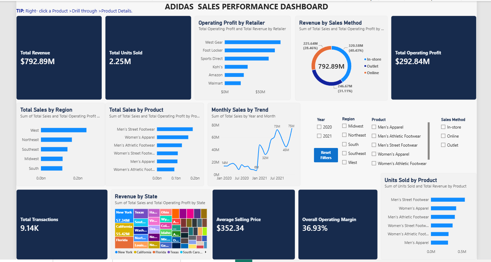
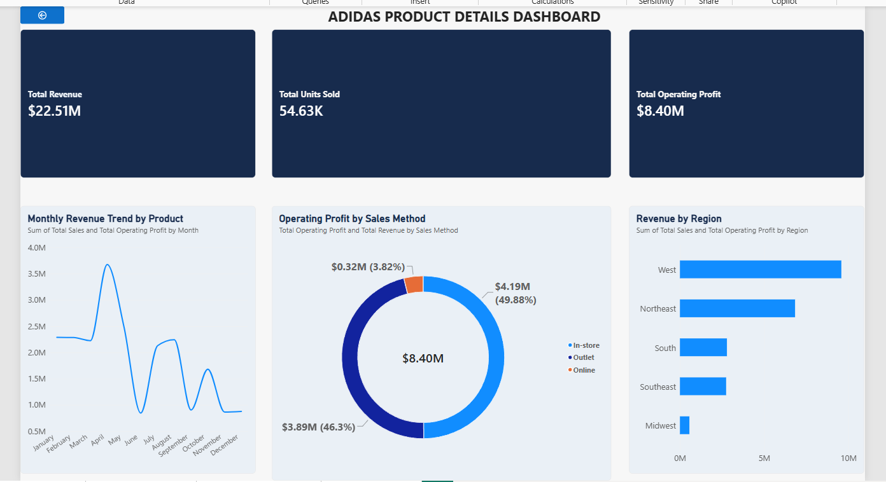
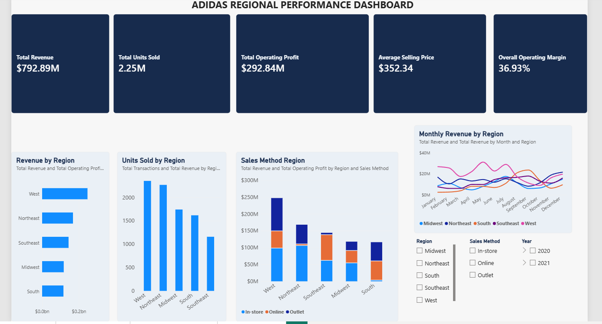
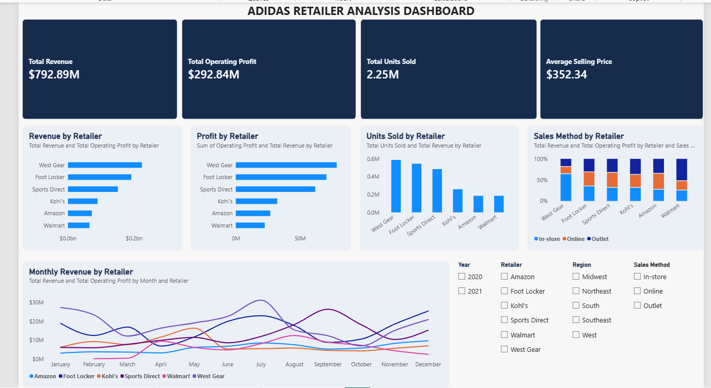

# Adidas Sales Performance Analysis

## Project Overview
This project analyzes Adidas sales performance using an interactive Power BI dashboard. The aim is to explore sales trends, product performance, regional performance, retailer contributions and sales methods using the available sales data.

## Project Objectives
- Analyze overall sales revenue and operating profit.
- Identify top-performing products.
- Compare sales performance across regions.
- Examine retailer performance.
- Explore monthly and quarterly sales trends.
- Understand the contribution of different sales methods.

## Tools Used
- Microsoft Excel – Data inspection and preparation.
- Microsoft Power BI – Data modelling, analysis and dashboard visualization.

## Dataset Overview
The dataset contains 9,648 sales records covering 2020 and 2021.

It includes information such as:
- Retailer and location
- Invoice date
- Product
- Price per unit
- Units sold
- Total sales
- Operating profit
- Operating margin
- Sales method

## Dashboard Pages

### 1. Sales Overview
Provides a summary of key performance indicators, sales trends, product performance and sales methods.

### 2. Product Details
A hidden drill-through page that allows users to explore the performance of individual products.

### 3. Regional Performance
Compares revenue, operating profit, units sold and sales methods across the five regions.

### 4. Retailer Analysis
Examines sales revenue, operating profit, units sold and monthly sales trends across retailers.

## Key Findings
- Total sales revenue was approximately **$792.89 million**.
- Total operating profit was approximately **$292.84 million**.
- Overall operating margin was **36.93%**.
- Total units sold were approximately **2.25 million**.
- Men's Street Footwear recorded the highest unit sales.
- In-store sales contributed the largest share among the sales methods.
- The West region performed strongly in the retailer and operating profit analysis.
- The quarterly regional visuals showed varying regional representation in 2020, while all five regions appeared in every quarter of 2021.

## Dashboard Features
- Interactive slicers and filters.
- KPI cards.
- Drill-through functionality.
- Custom tooltips.
- Monthly sales trend analysis.
- Reset filters bookmark.

## Conclusion
This project provided an opportunity to apply data preparation, data modelling and visualization skills to a real-world sales analysis task. The interactive dashboard makes it easier to explore Adidas sales performance from different perspectives and identify useful business insights.

## Dashboard Previews

### 1. Sales Overview

### 2. Product Details – Hidden Drill-Through Page

### 3. Regional Performance

### 4. Retailer Analysis

**Project Type:** Sales Performance Analysis.  
**Tool:** Microsoft Power BI.
